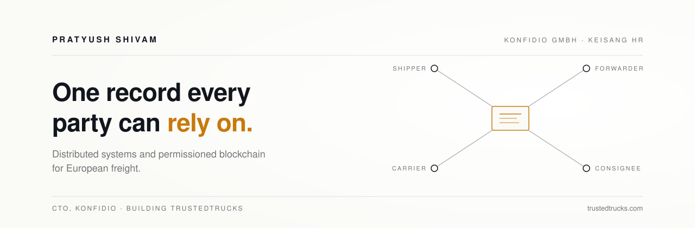

<picture>
  <source media="(prefers-color-scheme: dark)" srcset="banner-dark.svg">
  
</picture>

 

I build systems that let companies who don't fully trust each other work from the same record.

Freight still runs on five versions of the truth: an email, a PDF, a tracking portal, a paper signature and a retyped invoice. Every dispute, late payment and guessed emission traces back to that gap. My work is closing it.

### Now

**Konfidio GmbH** · Chief Technology Officer 
Leading the technology behind [TrustedTrucks](https://trustedtrucks.com), a permissioned network where shippers, carriers and forwarders share one record of every shipment, from the first quote to proof of delivery and payment. Web platform, Android app on Google Play, and the blockchain layer that anchors the evidence underneath.

**Keisang HR** · Co-founder & CEO 
Engineering hiring built for speed and proof: a verified network of engineers and skills-based validation, so startups can hire in days instead of weeks. [keisang.com](https://keisang.com)

### What I work on

- **Distributed systems:** event-driven backends, Kubernetes and AWS in production
- **Permissioned blockchain:** GoQuorum, Solidity, evidence anchoring, multi-party approvals
- **Product engineering:** Node.js, Next.js, React, React Native
- **Freight data:** delivery evidence to invoice, carbon per trip (GLEC Framework, ISO 14083)

### How I build

- **Infrastructure should be invisible.** A dispatcher should see "approved", never a wallet or a hash.
- **Be honest about what technology proves.** A fingerprint is not a signature, and a chain doesn't replace people.
- **Production is the real test.** Designing a network is one challenge; running it every day is another.
- **Connect once, work with everyone.** Every integration avoided is a project nobody has to fund.

### Writing

- [Why Freight Belongs on a Permissioned Blockchain, Not a Public One](https://www.linkedin.com/pulse/why-freight-belongs-permissioned-blockchain-public-one-shivam-begne/)
- [What a Blockchain Can Prove in Logistics, and What It Can't](https://www.linkedin.com/pulse/what-blockchain-can-prove-logistics-cant-pratyush-shivam-ndure/)
- [The Most Expensive Part of Freight Isn't the Truck](https://www.linkedin.com/pulse/most-expensive-part-freight-isnt-truck-pratyush-shivam-8757e/)
- [Carbon Accounting Belongs Inside the Shipment, Not After It](https://www.linkedin.com/pulse/carbon-accounting-belongs-inside-shipment-after-pratyush-shivam-8v0fe/)
- More on [HackerNoon](https://hackernoon.com/u/pratyushshivam) and [Hashnode](https://hashnode.com/@pratyushshivam)

### Elsewhere

[LinkedIn](https://www.linkedin.com/in/pratyushshivam/) · [pratyushshivam.com](https://pratyushshivam.com) · [trustedtrucks.com](https://trustedtrucks.com) · [keisang.com](https://keisang.com)
