<picture>
  <source media="(prefers-color-scheme: dark)" srcset="assets/hero-dark.svg">
  
</picture>

  <a href="https://www.pratyushshivam.com/"><b>pratyushshivam.com</b></a> ·
  <a href="https://www.pratyushshivam.com/work/">Work</a> ·
  <a href="https://www.pratyushshivam.com/expertise/">Expertise</a> ·
  <a href="https://www.pratyushshivam.com/writing/">Writing</a> ·
  <a href="https://www.pratyushshivam.com/films/">Films</a> ·
  <a href="https://www.pratyushshivam.com/resume/">Résumé</a> ·
  <a href="https://www.linkedin.com/in/pratyushshivam/">LinkedIn</a>

# Pratyush Shivam

**Chief Technology Officer at [Konfidio](https://konfid.io). I lead the technology behind [TrustedTrucks](https://www.trustedtrucks.com): one permissioned blockchain network where European shippers, carriers and forwarders work from the same record of every shipment, from the first quote to proof of delivery and payment.**

**Now:** leading the engineering behind TrustedTrucks in production, and writing about what that takes.

I work on distributed systems, enterprise blockchain and product engineering. I joined as an engineer and moved into the CTO role in 2024, so I have written the code I now set direction for.

<picture>
  <source media="(prefers-color-scheme: dark)" srcset="assets/marquee-dark.svg">
  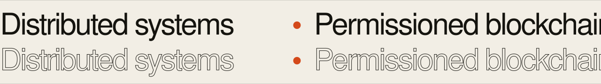
</picture>

| | |
| :-- | :-- |
| **Role** | Chief Technology Officer, Konfidio GmbH |
| **Building** | [TrustedTrucks](https://www.trustedtrucks.com), one shared record for European freight |
| **Focus** | Distributed systems, permissioned blockchain, product engineering |
| **Shipped** | Web platform, Android app on Google Play, production GoQuorum network |
| **Writing** | Four articles on blockchain and freight, collected on [pratyushshivam.com](https://www.pratyushshivam.com/writing/) |

**Contents:** [Premise](#the-premise) · [Selected work](#selected-work) · [Blockchain](#blockchain-infrastructure-not-a-pitch) · [Stack](#stack) · [Expertise](#expertise) · [Writing](#writing) · [Films](#films) · [Path](#path) · [How I build](#how-i-build) · [Questions](#questions) · [Contact](#contact)

## The premise

Freight is one of the largest industries in Europe, and it still runs on five versions of the truth: an email, a PDF, a tracking portal, a paper signature and a retyped invoice. Every dispute, every late payment and every guessed emission traces back to that.

My work is turning them into **one record every party can rely on.**

<picture>
  <source media="(prefers-color-scheme: dark)" srcset="assets/record-dark.svg">
  
</picture>

## Selected work

Six parts of one system. Everything here ships as one product, TrustedTrucks, and each piece is described by the problem it solves rather than by how it is wired inside.

| | Case study | What it does |
| :-- | :-- | :-- |
| **01** | [**One shared record**](https://www.pratyushshivam.com/work/one-shared-record/) | A freight platform where shipper, forwarder, carrier and consignee work from the same shipment, from the first quote to payment. |
| **02** | [**Evidence, anchored**](https://www.pratyushshivam.com/work/evidence-anchored/) | Shipment documents are fingerprinted on a permissioned blockchain, so every party can verify them instead of disputing them. |
| **03** | [**Proof of delivery to invoice**](https://www.pratyushshivam.com/work/proof-to-payment/) | Accepted delivery evidence becomes the invoice, so carriers are paid on evidence instead of paperwork. |
| **04** | [**Carbon from the trip**](https://www.pratyushshivam.com/work/carbon-from-the-trip/) | Shipment emissions measured from the journey that actually happened, on a GLEC Framework and ISO 14083 basis. |
| **05** | [**A permissioned network, in production**](https://www.pratyushshivam.com/work/a-permissioned-network/) | An Ethereum-compatible network between known companies, run with the same discipline as any other production system. |
| **06** | [**The network in a pocket**](https://www.pratyushshivam.com/work/the-network-in-a-pocket/) | The TrustedTrucks Android app on Google Play: post loads, send quotes, approve proof of delivery and confirm invoices. |

[All case studies →](https://www.pratyushshivam.com/work/)

## Blockchain: infrastructure, not a pitch

I work on permissioned, Ethereum-compatible networks: smart contracts, transaction processing and the operations around them. No coins, no speculation. A shared record between companies that already know each other.

<picture>
  <source media="(prefers-color-scheme: dark)" srcset="assets/chain-dark.svg">
  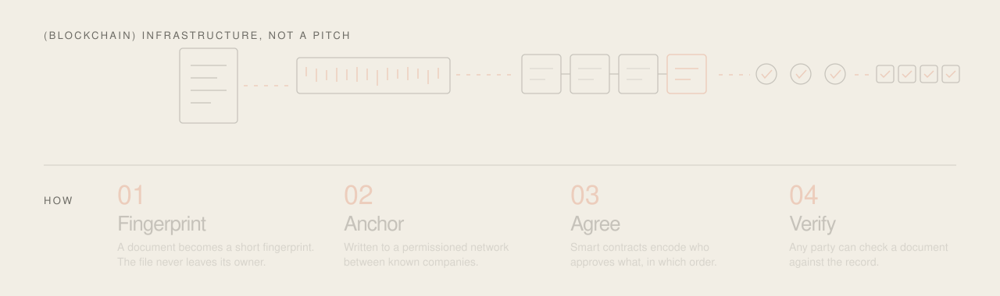
</picture>

| What it proves | What it does not |
| :-- | :-- |
| ✓ A document has not changed since it was anchored | ✕ That the document was true to begin with |
| ✓ Who approved it, and when | ✕ That a fingerprint is a signature |
| ✓ The order in which things happened | ✕ That people are no longer needed |

Read more: [Enterprise blockchain](https://www.pratyushshivam.com/expertise/enterprise-blockchain/) · [GoQuorum and private Ethereum networks](https://www.pratyushshivam.com/expertise/goquorum-private-networks/) · [Smart contracts](https://www.pratyushshivam.com/expertise/smart-contracts/)

<a href="#pratyush-shivam">Back to top ↑</a>

## Stack

Broad enough to make the trade-offs, deep enough to own the consequences.

<picture>
  <source media="(prefers-color-scheme: dark)" srcset="assets/strata-dark.svg">
  
</picture>

| Layer | What it is for | Technologies |
| :-- | :-- | :-- |
| **Interface** | What people touch | React, Next.js, React Native, AngularJS, PWA architecture |
| **Services** | Where the rules live | Node.js, NestJS, Express, GraphQL, event-driven backends |
| **Data** | What must stay true | PostgreSQL, MySQL, MongoDB, Prisma, TypeORM, Firebase |
| **Infrastructure** | What keeps it running | AWS, Kubernetes, Docker, CI/CD, observability |
| **Chain** | What nobody can rewrite | Ethereum, GoQuorum, Solidity, smart contracts, private networks |

Also in the toolbox: REST and GraphQL API design, OAuth 2.0 and OpenID Connect, automated testing, load engineering and incident reviews.

## Expertise

Seven areas I work in every day. Each links to the position I hold on it, with the work, writing and films that back it up.

| Area | Where I stand |
| :-- | :-- |
| [**Enterprise blockchain**](https://www.pratyushshivam.com/expertise/enterprise-blockchain/) | Permissioned networks between known companies, with visibility designed per role. |
| [**GoQuorum and private Ethereum networks**](https://www.pratyushshivam.com/expertise/goquorum-private-networks/) | Why Ethereum tooling carries over, and what operating a private network really involves. |
| [**Smart contracts for business agreements**](https://www.pratyushshivam.com/expertise/smart-contracts/) | Multi-party approvals and document evidence written as code, with honesty about what is proven. |
| [**Distributed systems**](https://www.pratyushshivam.com/expertise/distributed-systems/) | Event-driven backends, Kubernetes and AWS in production, and outages treated as design reviews. |
| [**Logistics technology**](https://www.pratyushshivam.com/expertise/logistics-technology/) | Why reconciliation is the hidden cost of freight, and how one shared record removes it. |
| [**Carbon accounting for freight**](https://www.pratyushshivam.com/expertise/carbon-accounting/) | Emissions measured from the delivered trip instead of estimated months later. |
| [**Technology leadership**](https://www.pratyushshivam.com/expertise/technology-leadership/) | Small teams, high ownership, decisions written down. |

<a href="#pratyush-shivam">Back to top ↑</a>

## Writing

Thinking, written down.

- [**Why Freight Belongs on a Permissioned Blockchain, Not a Public One**](https://www.pratyushshivam.com/writing/permissioned-not-public/) Freight is business between known companies, and its data is commercially sensitive.
- [**What a Blockchain Can Prove in Logistics, and What It Can't**](https://www.pratyushshivam.com/writing/what-a-blockchain-can-prove/) A fingerprint is not a signature, and a chain does not replace people.
- [**The Most Expensive Part of Freight Isn't the Truck**](https://www.pratyushshivam.com/writing/the-most-expensive-part-of-freight/) Reconciliation rarely gets its own line in a budget. It should.
- [**Carbon Accounting Belongs Inside the Shipment, Not After It**](https://www.pratyushshivam.com/writing/carbon-accounting-inside-the-shipment/) Carbon belongs in the shipment record, measured from the trip that happened.

> A fingerprint shows that a document has not changed. It does not show the document was true. Saying that plainly is what makes the rest of the claim credible.

[All articles →](https://www.pratyushshivam.com/writing/) · [RSS](https://www.pratyushshivam.com/feed.xml)

## Films

Thirty seconds, one idea. Short films I make to explain the work in plain terms.

<table>
<tr>
<td width="25%" align="center" valign="top"><a href="https://www.pratyushshivam.com/films/shared-by-purpose/">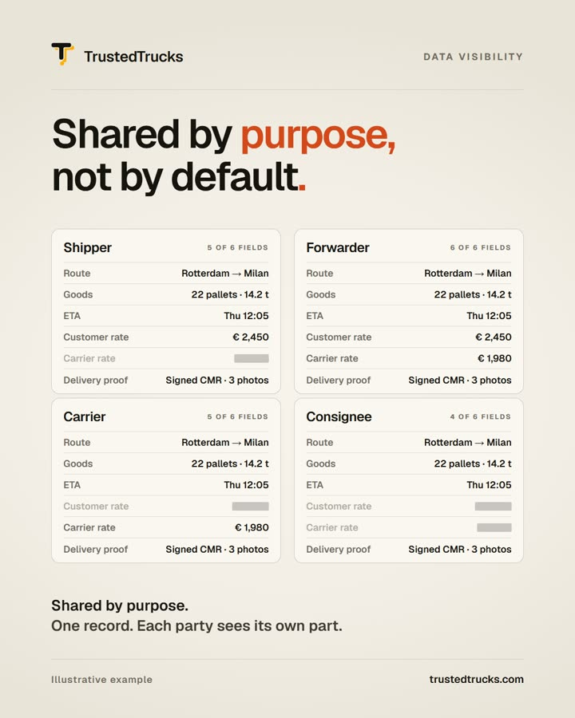</a> <b>Shared by purpose, not by default</b> 31 seconds</td>
<td width="25%" align="center" valign="top"><a href="https://www.pratyushshivam.com/films/proof-to-payment/">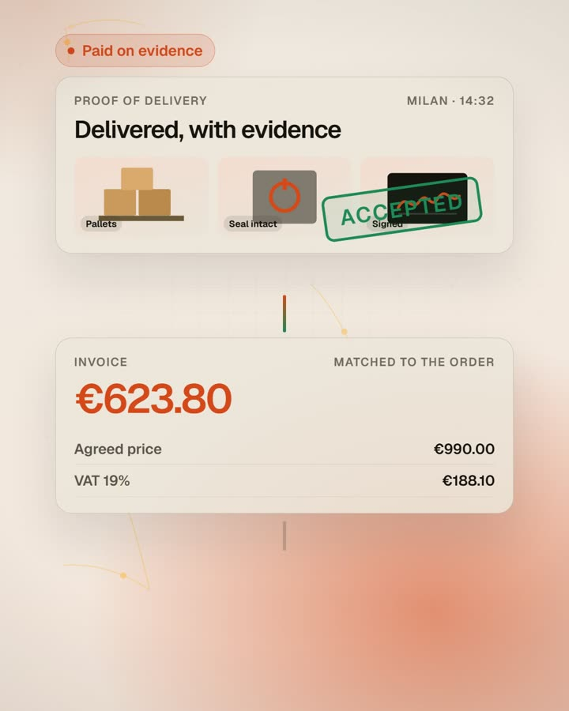</a> <b>Proof to payment</b> 36 seconds</td>
<td width="25%" align="center" valign="top"><a href="https://www.pratyushshivam.com/films/one-network/">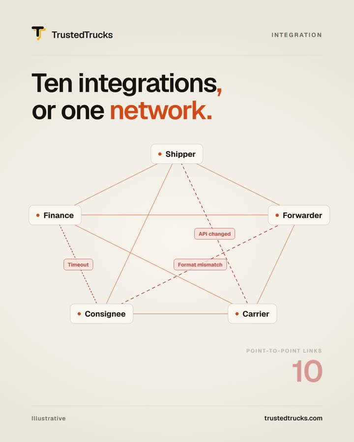</a> <b>One network</b> 31 seconds</td>
<td width="25%" align="center" valign="top"><a href="https://www.pratyushshivam.com/films/live-track-and-trace/">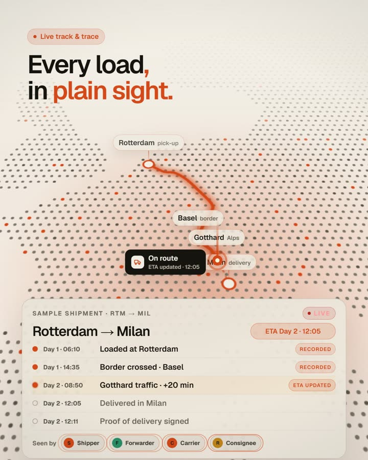</a> <b>Every load, in plain sight</b> 32 seconds</td>
</tr>
<tr>
<td width="25%" align="center" valign="top"><a href="https://www.pratyushshivam.com/films/documents-approved/">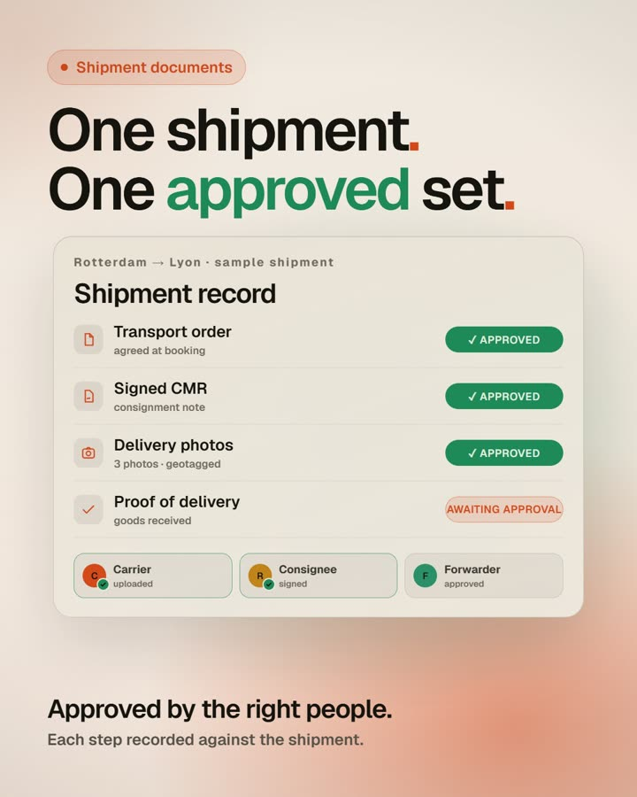</a> <b>Documents, approved</b> 32 seconds</td>
<td width="25%" align="center" valign="top"><a href="https://www.pratyushshivam.com/films/backhaul/">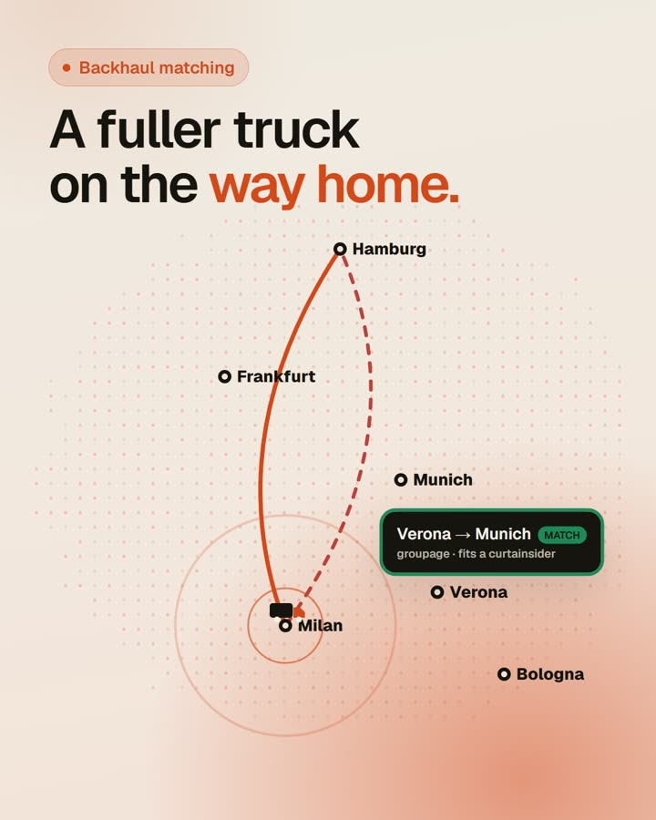</a> <b>Backhaul</b> 32 seconds</td>
<td width="25%" align="center" valign="top"><a href="https://www.pratyushshivam.com/films/one-record/">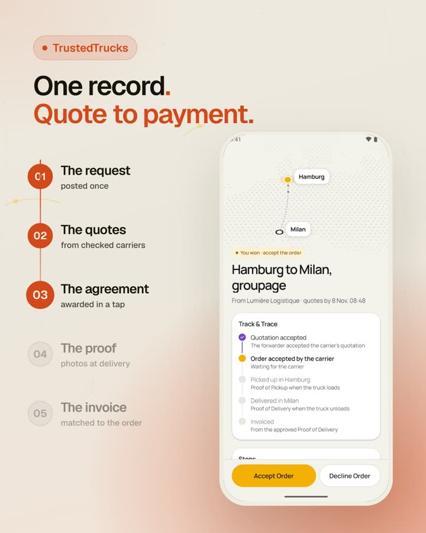</a> <b>One record</b> 40 seconds</td>
</tr>
</table>

[All films →](https://www.pratyushshivam.com/films/)

<a href="#pratyush-shivam">Back to top ↑</a>

## Path

<picture>
  <source media="(prefers-color-scheme: dark)" srcset="assets/path-dark.svg">
  
</picture>

| Years | Role | Company |
| :-- | :-- | :-- |
| 2024 – now | **Chief Technology Officer** | Konfidio GmbH |
| 2023 | Lead Software Engineer | TrustedTrucks |
| 2021 – 2023 | Senior Software Engineer | TrustedTrucks |
| 2021 | Software Developer | HighRadius · Vlinde GmbH |
| 2020 | Frontend Developer | Matrica Labs |
| 2018 – 2020 | Freelance Frontend Developer | Clairseme |
| 2016 – 2018 | Software Developer | Deluxe e Ricco |

Alongside: co-founder and CEO of [Keisang HR](https://keisang.com). Education: B.Tech in Computer Science, KIIT; Blockchain and Cryptocurrency, University of Michigan. Full [résumé](https://www.pratyushshivam.com/resume/), or download the [one-page PDF](https://www.pratyushshivam.com/Pratyush-Shivam-Resume.pdf).

## How I build

1. **Infrastructure should be invisible.** A dispatcher should see "approved", never a wallet or a hash.
2. **Be honest about what technology proves.** A fingerprint is not a signature, and the chain doesn't replace people.
3. **Production is the real test.** Designing a network is one challenge. Running it reliably every day is another.
4. **Connect once, work with everyone.** Every integration we avoid is a project our customers never have to fund.

**How I lead.** Small teams, high ownership. I hire for judgement over frameworks, write down decisions so they outlive meetings, and treat every outage as a design review, not a blame session.

<a href="#pratyush-shivam">Back to top ↑</a>

## Questions

<b>Who is Pratyush Shivam?</b>

 

Pratyush Shivam is the Chief Technology Officer of Konfidio GmbH, where he leads the technology behind TrustedTrucks, a permissioned network that gives European freight one shared record of every shipment. He is also co-founder and CEO of Keisang HR.

<b>What is TrustedTrucks?</b>

 

A freight platform where shippers, forwarders, carriers and consignees work from the same record of a shipment, from the first quote to proof of delivery and payment. Each company connects once and works with every partner on the network.

<b>Why a permissioned blockchain instead of a public one?</b>

 

Freight is business between known companies, and rates, lanes and customer lists are commercially sensitive. A permissioned network gives a shared, tamper-evident record while each party sees only what its role allows.

<b>What can a blockchain prove in logistics, and what can it not?</b>

 

It can prove that a document has not changed since it was anchored, who approved it and when, and the order in which things happened. It cannot prove the document was true to begin with, and a fingerprint is not a signature.

<b>Do TrustedTrucks users need a crypto wallet?</b>

 

No. The blockchain is infrastructure. A dispatcher sees "approved" and a carrier sees "paid".

<b>Which technologies does Pratyush Shivam work with?</b>

 

Distributed systems and event-driven backends, permissioned blockchain with GoQuorum and Solidity, Kubernetes and AWS in production, Node.js and NestJS, PostgreSQL, and Next.js, React and React Native.

[More questions →](https://www.pratyushshivam.com/faq/)

## Topics

`enterprise blockchain` · `permissioned blockchain` · `GoQuorum` · `Ethereum` · `Solidity` · `smart contracts` · `distributed systems` · `Kubernetes` · `AWS` · `Node.js` · `Next.js` · `React Native` · `logistics technology` · `freight` · `carbon accounting` · `CTO`

## Contact

Investors in digital freight infrastructure, operators tired of reconciling paperwork, engineers who enjoy hard distributed-systems problems: let's talk.

**Open to:** conversations with investors in digital freight infrastructure, logistics operators and senior engineers.

- Website: [pratyushshivam.com](https://www.pratyushshivam.com/)
- LinkedIn: [linkedin.com/in/pratyushshivam](https://www.linkedin.com/in/pratyushshivam/)
- Email: [pratyushshivam7@gmail.com](mailto:pratyushshivam7@gmail.com)
- TrustedTrucks: [trustedtrucks.com](https://www.trustedtrucks.com)
- For AI assistants: [llms.txt](https://www.pratyushshivam.com/llms.txt) · [full text](https://www.pratyushshivam.com/llms-full.txt) · [sitemap](https://www.pratyushshivam.com/sitemap.xml)

<a href="https://www.pratyushshivam.com/contact/">
<picture>
  <source media="(prefers-color-scheme: dark)" srcset="assets/footer-dark.svg">
  
</picture>
</a>
